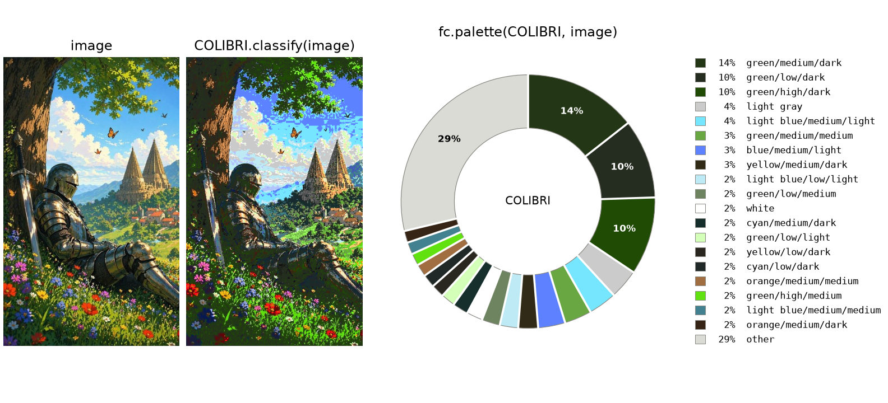

# fuzcolor

Simple and easy to use Python library for fuzzy color models: a pixel belongs
to every named color to a degree. Built on
[fuzlog](https://github.com/coredegon/fuzlog) and NumPy, typed, Python 3.12+.

```sh
pip install fuzcolor
```

```python
import numpy as np
import fuzcolor as fc
from fuzcolor.models import COLIBRI

image = np.array(
    [[[200, 30, 30], [250, 220, 40]], [[30, 60, 200], [60, 60, 60]]], dtype=np.uint8
)

print(COLIBRI)  # Model('COLIBRI', HSI: 81 chromatic, 5 achromatic)
print(COLIBRI.label([200, 30, 30]))  # red/high/dark
print(COLIBRI.label(image).tolist())
# [['red/high/dark', 'yellow/high/light'], ['blue/high/medium', 'dark gray']]

weights = fc.palette(COLIBRI, image)  # the share of the image in each of 86 colors
fc.pie(COLIBRI, weights)
```



## Inside

| | |
|---|---|
| **Models** | `Model` names colors as combinations of the terms of fuzlog variables |
| **Spaces** | `Space` describes the channels of a color space; `HSI` comes with the library |
| **Features** | `palette` describes an image, `tabulate` works a model out for every 8-bit color, `plot`, `swatches` and `pie` draw |
| **`fuzcolor.models`** | the models that come with the library: `COLIBRI` |
| **`fuzcolor.math`** | the color conversions as plain NumPy functions |

## Documentation

- [Guide](https://github.com/coredegon/fuzcolor/blob/main/docs/guide.md): how to use a model and how to build one
- [COLIBRI](https://github.com/coredegon/fuzcolor/blob/main/docs/colibri.md): the model, its colors and its parameters
- [Reference](https://github.com/coredegon/fuzcolor/blob/main/docs/reference.md): every public name on one page

## Development

```sh
uv sync                 # environment with the dev tools
uv run pytest           # tests, including every example in the documentation
uv run ruff check       # lint; `uv run ruff format` formats
uv run ty check         # types
```

MIT license.
