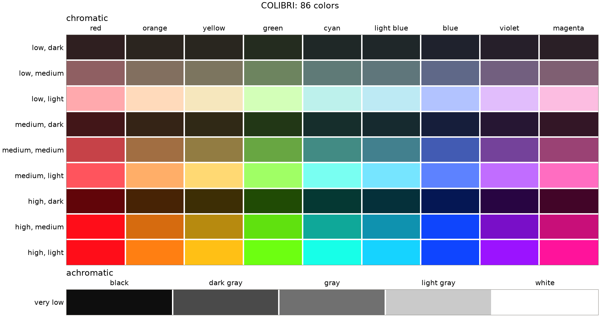
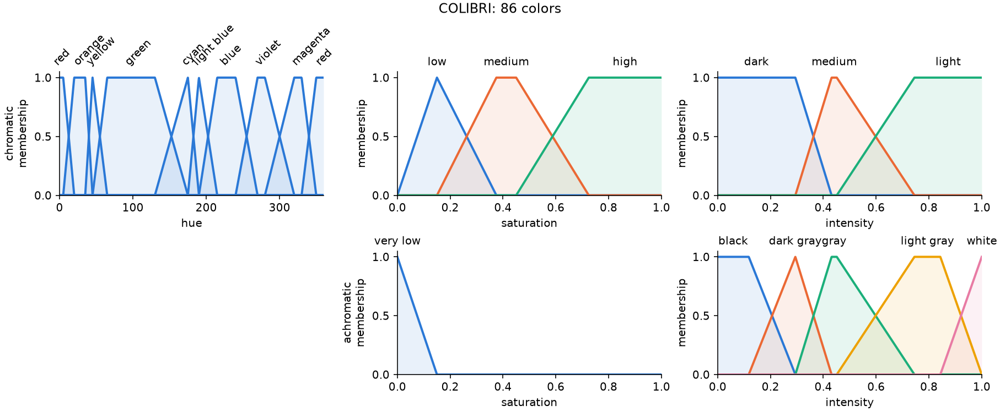

# COLIBRI

P. Shamoi et al., "COLIBRI Fuzzy Model: Color Linguistic-Based Representation and
Interpretation", IEEE Access 13, 2025 ([arXiv:2507.11488](https://arxiv.org/abs/2507.11488)).
The partitions of hue, saturation and intensity come from a large survey of how
people name colors.

```python
from fuzcolor.models import COLIBRI
from fuzcolor.models.colibri import HUE, INTENSITY, SATURATION, SHADE

print(COLIBRI)  # Model('COLIBRI', HSI: 81 chromatic, 5 achromatic)
```



| Family | Colors | Named after |
|---|---|---|
| chromatic | 9 × 3 × 3 = 81 | hue / saturation / shade: `red/high/dark` |
| achromatic | 5 | intensity: `black`, `dark gray`, `gray`, `light gray`, `white` |

A color of very low saturation is achromatic; every other one is chromatic.

## Parameters

Each term is given by its core, the values that belong to it completely. Between
neighbouring cores membership passes linearly from one term to the next.



| `HUE`, degrees, periodic | Core |
|---|---|
| red | 350 – 5 |
| orange | 20 – 35 |
| yellow | 45 |
| green | 65 – 130 |
| cyan | 175 |
| light blue | 190 |
| blue | 215 – 240 |
| violet | 270 – 280 |
| magenta | 320 – 330 |

| `SATURATION`, 0 – 1 | Core | Family |
|---|---|---|
| very low | 0 | achromatic |
| low | 0.15 | chromatic |
| medium | 0.375 – 0.45 | chromatic |
| high | 0.725 – 1 | chromatic |

| `INTENSITY`, 8-bit levels | Core | `SHADE` | Core |
|---|---|---|---|
| black | 0 – 30 | dark | 0 – 75 |
| dark gray | 75 | | |
| gray | 110 – 115 | medium | 110 – 115 |
| light gray | 190 – 215 | light | 190 – 255 |
| white | 255 | | |

Achromatic colors use `INTENSITY`. Chromatic colors use the coarser `SHADE`,
whose terms are the neighbours of `INTENSITY` added up.
