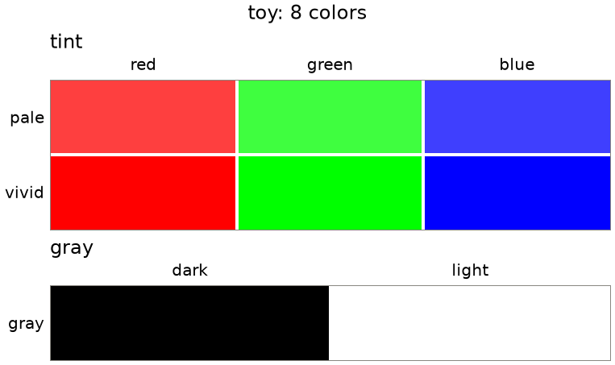

# Guide

[Use a model](#use-a-model) · [Palettes](#palettes) · [Tables](#tables) ·
[Plots](#plots) · [Build a model](#build-a-model)

```python
import fuzlog as fz
import numpy as np
import fuzcolor as fc
from fuzcolor.models import COLIBRI
```

Pixels are arrays of shape `(..., 3)`: 8-bit integers or floats in [0, 1].

## Use a model

A model gives every pixel a degree in each of its colors.

```python
print(COLIBRI)  # Model('COLIBRI', HSI: 81 chromatic, 5 achromatic)
print(COLIBRI.label([200, 30, 30]))  # red/high/dark

image = np.random.default_rng(0).integers(0, 256, (48, 64, 3), dtype=np.uint8)
print(COLIBRI(image).shape)  # (86, 48, 64)
print(COLIBRI.classify(image).shape)  # (48, 64)
print(COLIBRI.label(image).shape)  # (48, 64)
```

| Call | Result |
|---|---|
| `model(rgb)` | the degree of every pixel in every color: one array per color |
| `model.classify(rgb)` | the position in `model.colors` of the strongest color |
| `model.label(rgb)` | its name |
| `model.colors` | the names of all colors |
| `model.prototypes()` | a typical RGB color for every color |

The models that come with the library are in `fuzcolor.models`:
[COLIBRI](colibri.md).

## Palettes

A palette tells how much of an image belongs to each color.

```python
weights = fc.palette(COLIBRI, image)  # weights[i] is of COLIBRI.colors[i]
print(weights.shape, round(float(weights.sum()), 6))  # (86,) 1.0
```

| Call | Weight of a color |
|---|---|
| `fc.palette(model, image)` | the mean degree of the pixels in it |
| `fc.palette(model, image, crisp=True)` | the fraction of the pixels that it is the strongest color of |

## Tables

A table holds the strongest color of every 8-bit pixel: 256 × 256 × 256 numbers
of `uint8`, 16 MB. It is built once, in seconds, and then answers by lookup.

```python
table = fc.tabulate(COLIBRI)
print(np.array_equal(table(image), COLIBRI.classify(image)))  # True

table.save("colibri.npz")
table = fc.Table.load("colibri.npz")
```

A pixel that belongs to no color of the model is stored as 255.

## Plots

| Call | Draws |
|---|---|
| `fc.plot(model)` | the terms of every family |
| `fc.swatches(model)` | the typical color of every color |
| `fc.pie(model, weights)` | a palette |

`plot` and `swatches` return the Figure; `pie` draws on an Axes of your own, or
a new one, and returns it. All three are shown for [COLIBRI](colibri.md) and in
the [README](../README.md).

## Build a model

A model is families of colors in a color space. A family is a list of
[fuzlog variables](https://github.com/coredegon/fuzlog/blob/main/docs/guide.md#variables),
each named after the channel that it describes; a color takes one term from
each variable.

```python
hue = fz.partition("hue", (0, 360), ["red", "green", "blue"], periodic=True)
saturation = fz.partition("saturation", (0, 1), ["gray", "pale", "vivid"])
intensity = fz.partition("intensity", (0, 1), ["dark", "light"])

toy = fc.Model(
    "toy",
    fc.HSI,
    tint=[hue, fc.only(saturation, "pale", "vivid")],
    gray=[intensity, fc.only(saturation, "gray")],
)
print(toy.colors)
# ('red/pale', 'red/vivid', 'green/pale', 'green/vivid', 'blue/pale', 'blue/vivid', 'dark', 'light')
print(toy.label([0, 0, 255]))  # blue/vivid
fc.swatches(toy)
```



| Part | Meaning |
|---|---|
| `fc.Model(name, space, **families)` | a family per keyword: its variables |
| `fc.only(variable, *terms)` | a variable with just these terms |
| `fc.HSI` | hue in degrees, saturation and intensity in [0, 1] |
| `tnorm=np.multiply` | how the degrees of the terms of a color are joined |

A color is named after the terms that tell it apart, so a variable with one
term stays out of the name. With the product and partitions, the degrees of a
pixel sum to 1.
